# Fidelyra

Multi-tenant loyalty platform: cards, points, stamps, rewards and group loyalty.

Customers collect digital cards, cashiers confirm visits with a rotating QR code, merchants manage loyalty programs and offers, and friends can combine points in Circles. The platform calculates loyalty and never processes money.

> **Structure only.** The source code is private. Source files here are intentionally empty so you can see how the project is organized. Commands describe the private codebase.

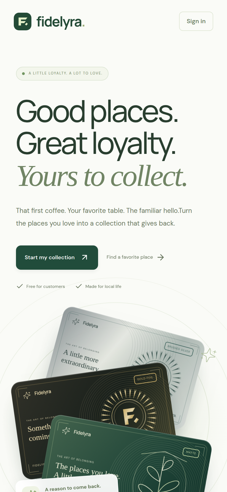

## Features

- Points, stamps and hybrid programs
- Rotating QR checkout
- Circles: shared rewards
- Discovery and favorites
- Offers and rewards
- Merchant analytics

## Applications

| Application | Role |
| --- | --- |
| [API server](server/README.md) | Express modular monolith |
| [Web application](client/README.md) | Installable React application |

## Architecture

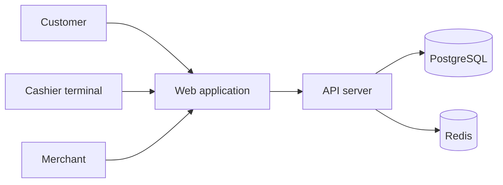

## Engineering highlights

- A ledger explains every balance change
- Row locks and idempotency keys around checkout
- QR tokens live seconds and are consumed atomically
- Refresh token families with reuse detection
- Amounts are integers in centimes

## Screenshots

| Landing | Explore |
| --- | --- |
|  | 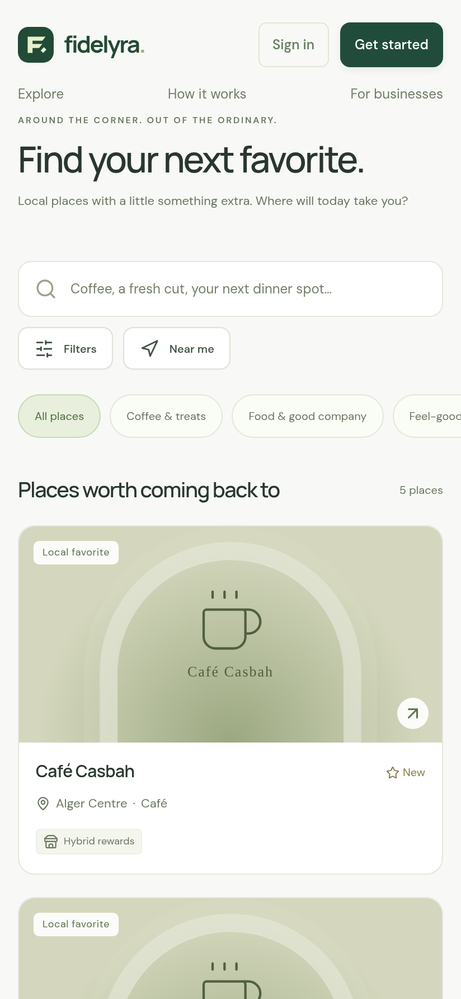 |
| **Business page** | **My cards** |
| 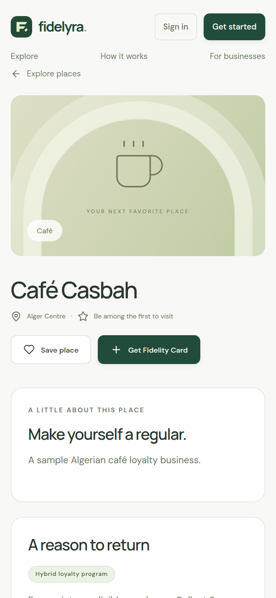 | 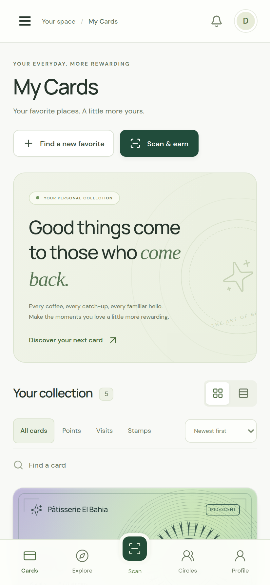 |
| **Circles** | **Rewards** |
| 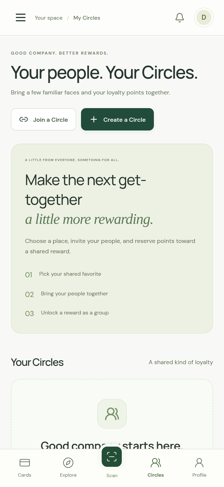 | 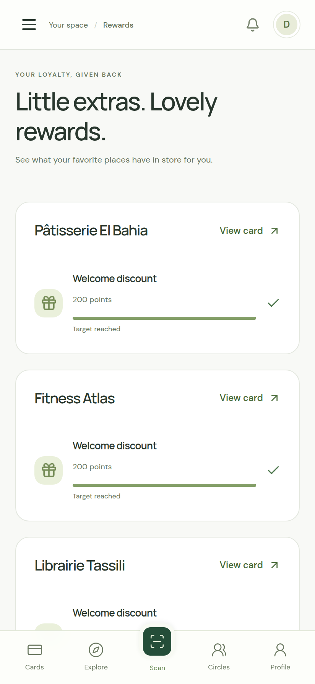 |
| **Merchant overview** | **Loyalty program** |
| 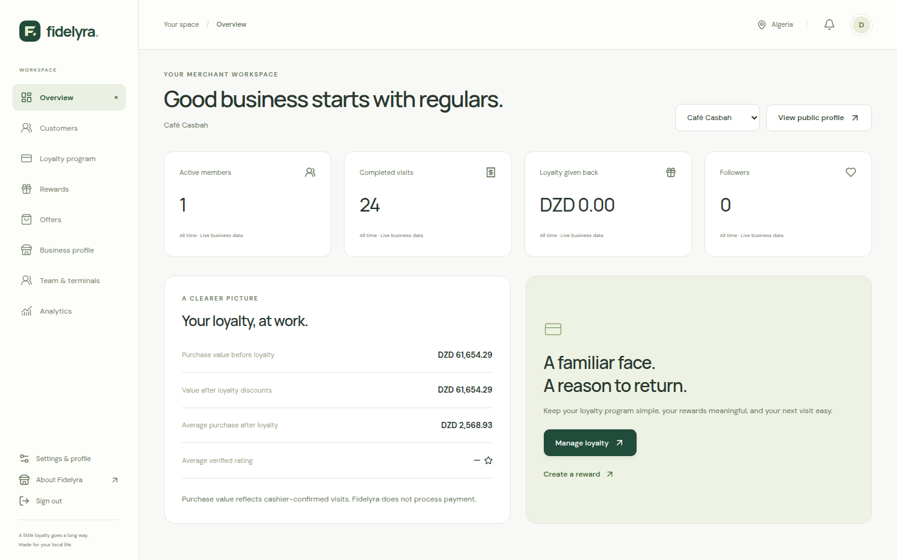 | 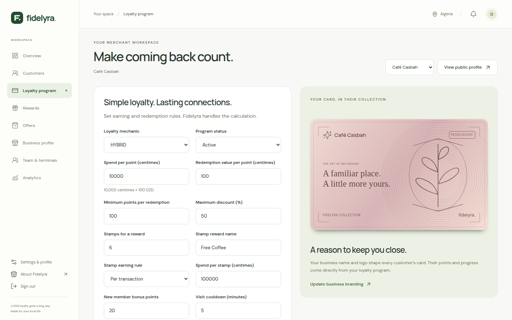 |
| **Customers** | **Rewards** |
| 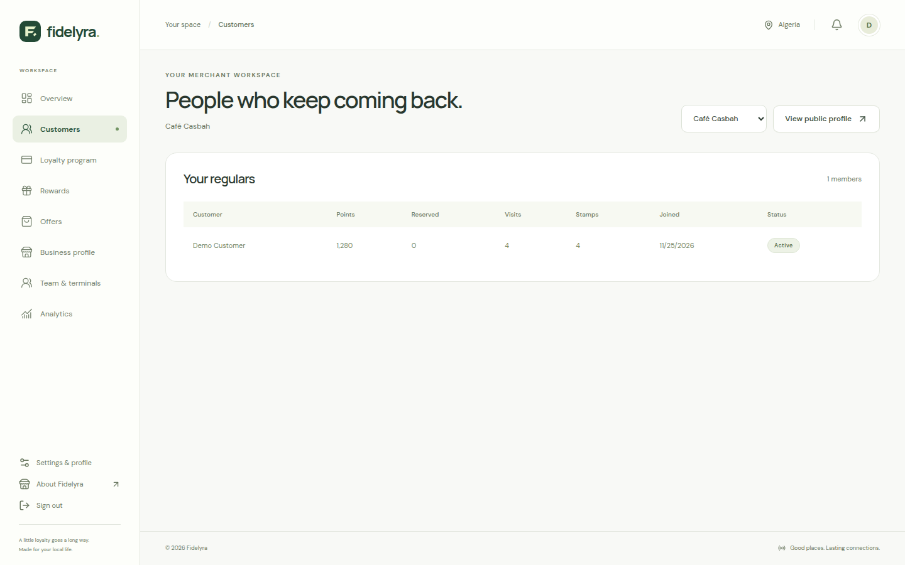 | 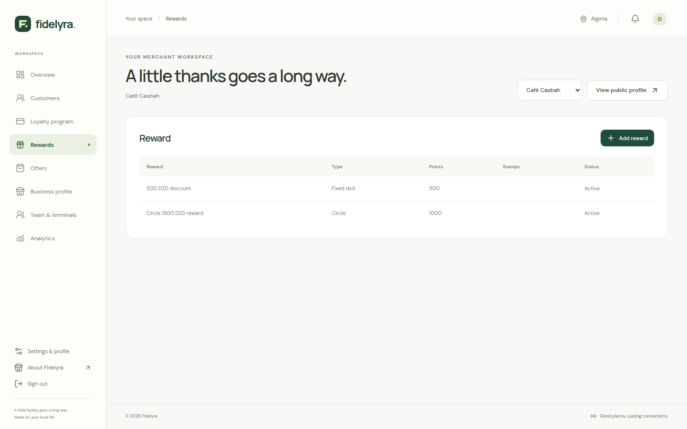 |
| **Team** | **Cashier terminal** |
| 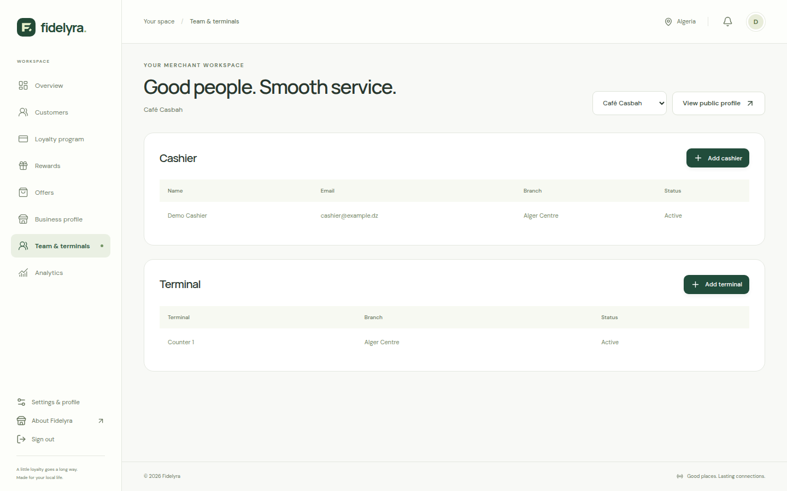 | 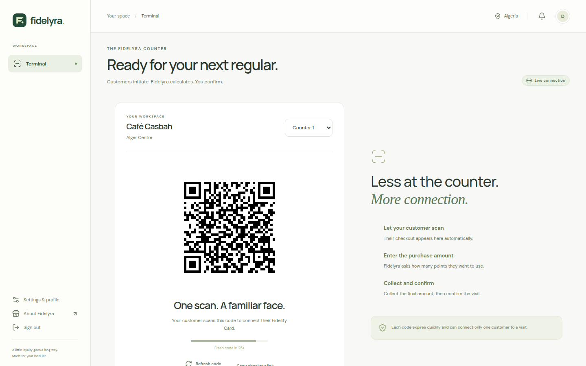 |
| **Administration** |
| 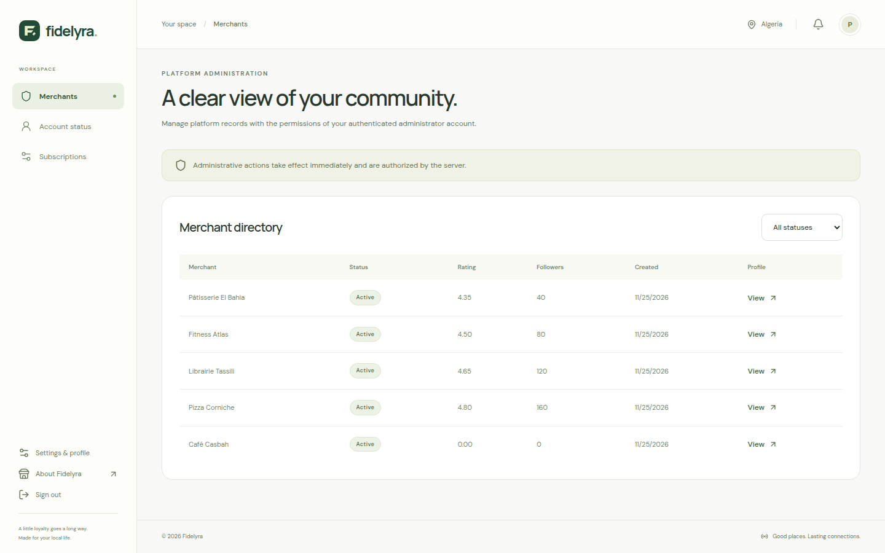 |

Captured from the real application on a local demo database.

## Repository layout

```text
server/                                 Express modular monolith
client/                                 Installable React application
docs/screenshots/
```

Each application has its own README with responsibilities, dependencies, structure and commands.

## Usage

Published for portfolio and presentation purposes. No license is granted for reuse.
