# Web application

Installable React application. Part of [Fidelyra](../README.md).

> **Structure only.** The source code is private. Source files here are intentionally empty so you can see how the project is organized. Commands describe the private codebase.

## Responsibilities

- Customer, merchant, cashier and administrator areas
- Card collection with ten finishes
- QR scanning
- Session restoration without storing tokens
- Offline-ready installable app

## Screenshots

| Landing | Explore |
| --- | --- |
| 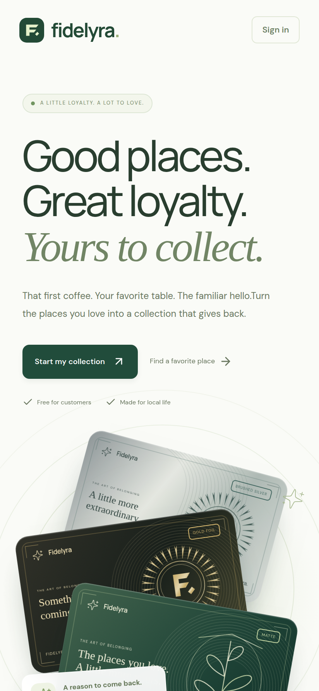 | 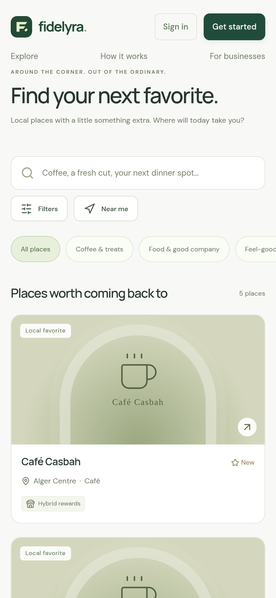 |
| **Business page** | **My cards** |
| 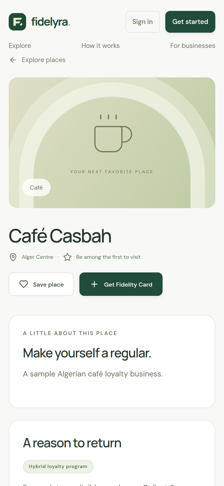 | 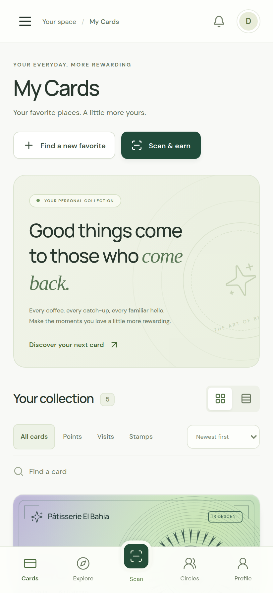 |
| **Circles** | **Rewards** |
|  |  |
| **Merchant overview** | **Loyalty program** |
| 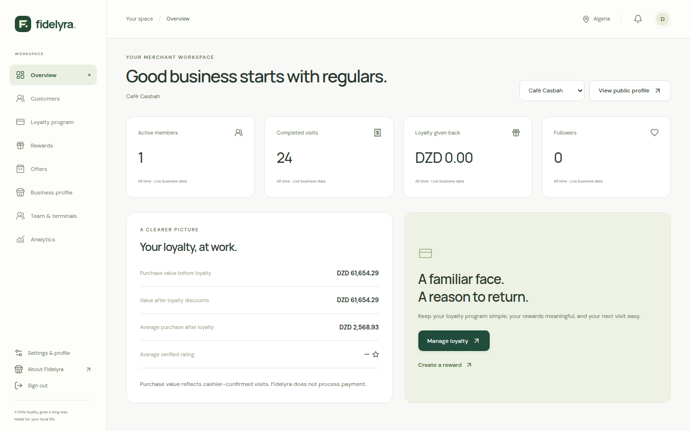 | 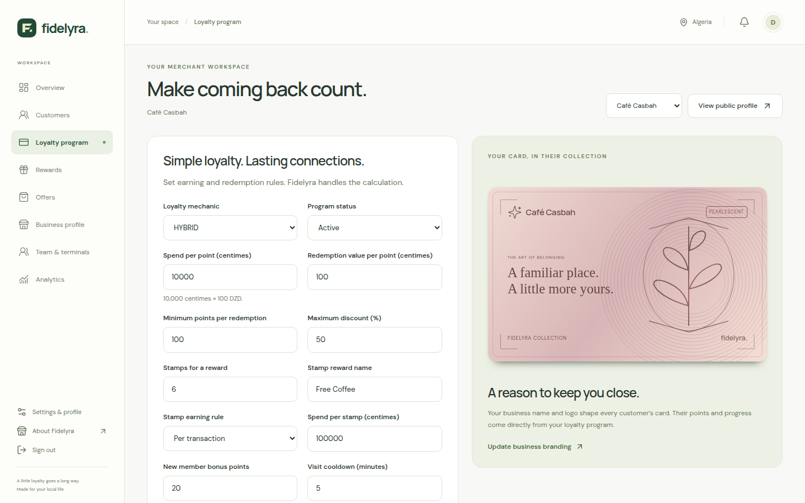 |
| **Customers** | **Rewards** |
| 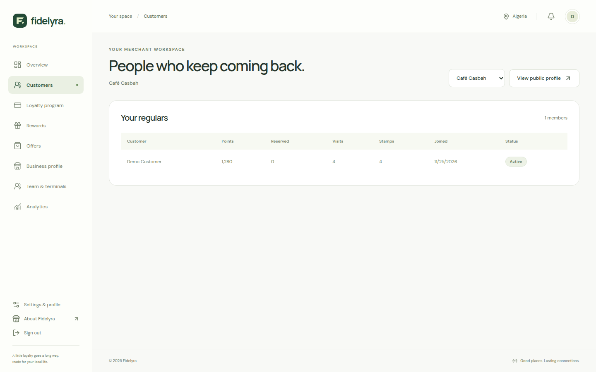 | 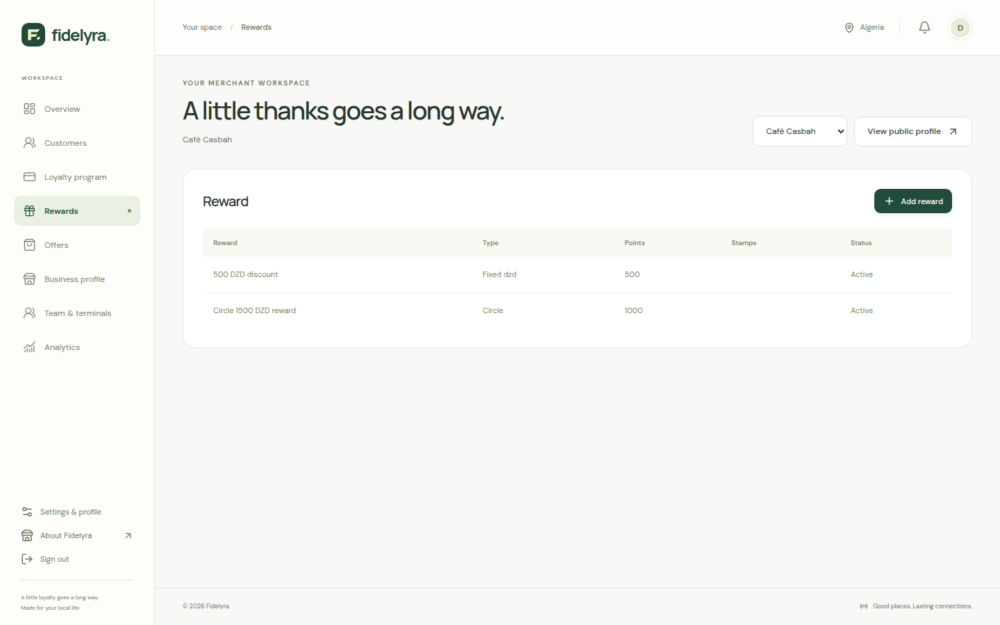 |
| **Team** | **Cashier terminal** |
| 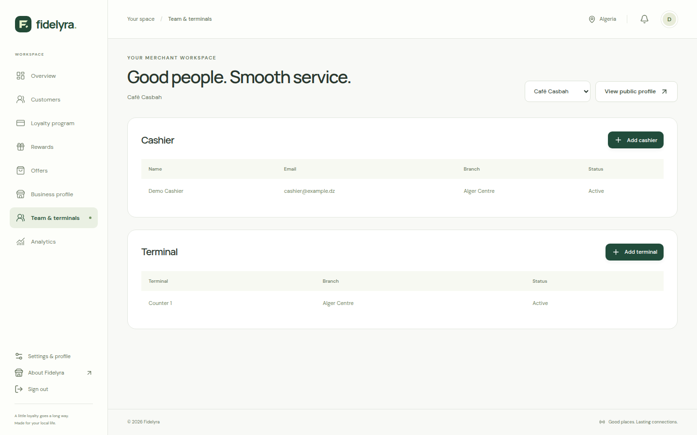 | 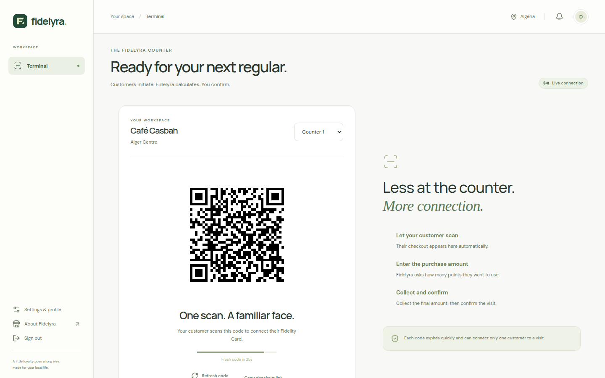 |
| **Administration** |
| 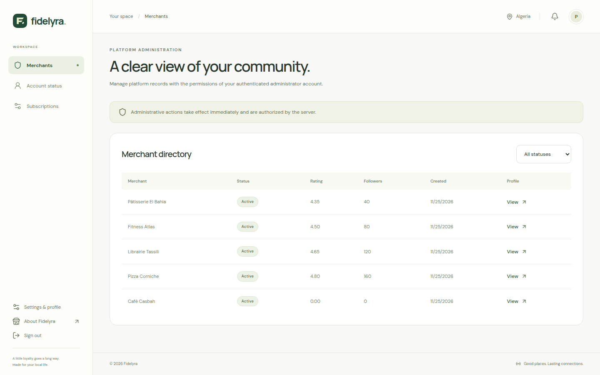 |

## Main dependencies

`@fontsource-variable/dm-sans`, `@fontsource-variable/manrope`, `@hookform/resolvers`, `@radix-ui/react-dialog`, `@radix-ui/react-slot`, `@tanstack/react-query`, `@tanstack/react-table`, `class-variance-authority`, `clsx`, `date-fns`, `html5-qrcode`, `lucide-react`, `qrcode.react`, `react`, `react-dom`, `react-hook-form`, `react-router-dom`, `socket.io-client`, `sonner`, `tailwind-merge`, `zod`

## Structure

```text
docs/                             3 files
public/                           3 files
scripts/                          1 file
src/app/                          2 files
src/assets/                       1 file
src/components/                   9 files
src/features/                     29 files
src/hooks/                        2 files
src/lib/                          6 files
src/                              2 files
tests/                            8 files
```

## Commands

```bash
npm install
npm run dev
npm run build
npm test
npm run lint
```
